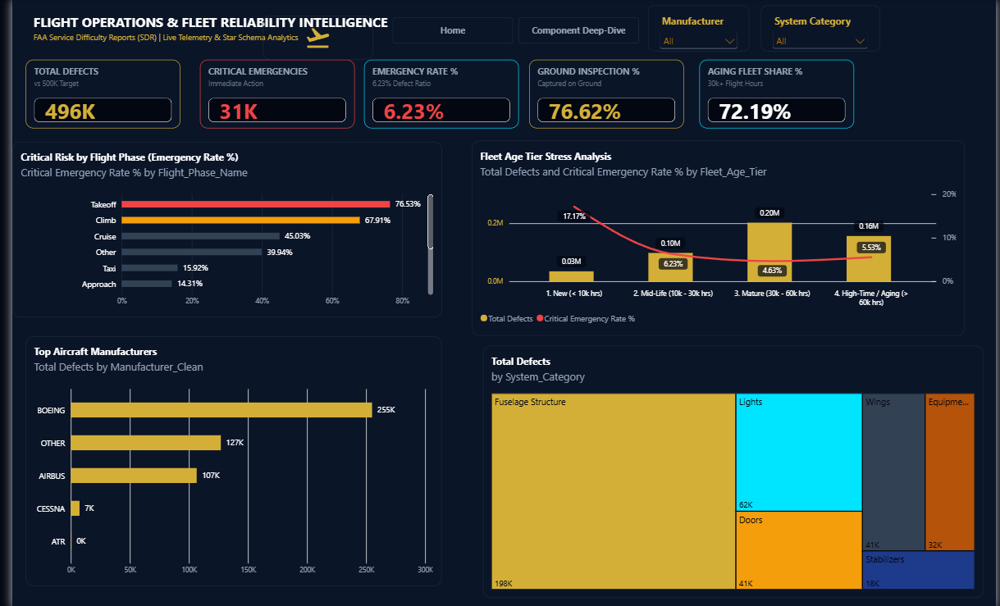
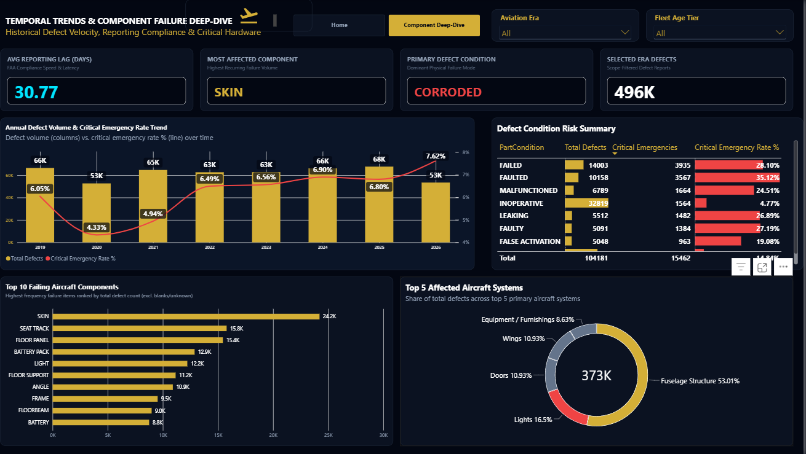

<div align="center">

# ✈️ Aviation Safety & Fleet Reliability Command Center
### End-to-End Operational Risk, Fleet Aging & Hardware Failure Telemetry (2019–2026)


**`496,000+ Validated Incidents`**  •  **`2019–2026 Operational Span`**  •  **`Star Schema Data Warehouse`**  •  **`3-Page Executive HUD`**

<br/>


</div>

---

## 🎯 Executive Summary

Commercial aviation safety relies on detecting structural fatigue and mechanical anomalies **before** an aircraft enters critical flight phases. This project transforms **496,000+ raw Federal Aviation Administration (FAA) Service Difficulty Reports (SDR)** spanning **2019–2026** into an end-to-end **Aviation Safety Command Center**.

Engineered across a complete **Python ➔ SQL Server ➔ Power BI** pipeline, the solution connects raw regulatory maintenance logs to executive decision-making—isolating high-risk flight phases, fleet aging inflection points, OEM reliability benchmarks, and hardware-level failure modes.

> **Core Operational Takeaway:** While **76.62%** of total defects are intercepted proactively during ground maintenance, anomalies occurring during **Takeoff** carry a **76.53%** critical emergency conversion rate—and **72.19%** of all reported defects originate from airframes exceeding **30,000 flight hours**.

---

## 📊 Key Telemetry Benchmarks

| Telemetry Metric | Measured Value | Operational & Safety Significance |
| :--- | :---: | :--- |
| **Validated Defect Reports** | **`496K`** | Multi-year FAA SDR incident volume across commercial & regional fleets |
| **Critical Emergencies** | **`31K`** | High-severity anomalies requiring immediate precautionary procedures (`Codes A–D`) |
| **Overall Emergency Rate** | **`6.23%`** | Baseline conversion rate from reported defect to critical operational emergency |
| **Takeoff Emergency Rate** | **`76.53%`** | Highest-risk flight phase (`67.91%` during Climb vs. `14.31%` on Approach) |
| **Ground Inspection Capture** | **`76.62%`** | Share of total defects detected proactively prior to aircraft dispatch |
| **Aging Fleet Share (`30k+ hrs`)** | **`72.19%`** | Majority of defects concentrated in Mature (`30k–60k`) & High-Time (`>60k`) fleets |
| **Primary Structural Vulnerability** | **`53.01%`** | **Fuselage Structure** share of Top 5 systems; **SKIN** (`24.2K`) is the #1 failing part |
| **Mean Reporting Latency** | **`30.77 Days`** | Average regulatory reporting lag between defect occurrence and FAA submission |

---

## 🖥️ Executive Dashboard Showcase

### Page 1 — Command Briefing (`Custom HTML/CSS Telemetry HUD`)
* **Embedded Dark-Mode HUD:** Custom HTML/CSS/SVG aviation briefing interface integrated directly inside Power BI.
* **Live DAX Telemetry Cards:** Real-time tracking of **`496K` Total Defects**, **`31K` Critical Alerts**, **`6.23%` Emergency Rate**, and **`72.19%` Aging Fleet Share** with one-click cross-page navigation.

---

### Page 2 — Executive Command Center (`Operational Risk & Fleet Stress`)
* **Flight Phase Risk Ranking:** **Takeoff (`76.53%`)** and **Climb (`67.91%`)** exhibit the highest emergency conversion rates, compared to Cruise (`45.03%`) and Approach (`14.31%`).
* **Fleet Age Tier Stress Curve:** Defect volume peaks in **Mature airframes (`30k–60k hrs`)** at `0.20M` reports, while **High-Time airframes (`>60k hrs`)** record `0.16M` reports with a resurgent **`5.53%`** emergency rate.
* **OEM & System Breakdown:** **Boeing (`255K`)** and **Airbus (`107K`)** lead reported volume; **Fuselage Structure (`198K`)**, **Lights (`62K`)**, **Wings (`41K`)**, and **Doors (`41K`)** dominate affected systems.

<p align="center">
  
</p>

---

### Page 3 — Temporal Trends & Component Deep-Dive (`2019–2026`)
* **Frequency vs. Lethality Contrast:** While **`INOPERATIVE`** generates the highest volume (`32,819` reports at `4.77%` emergency rate), **`FAULTED` (`35.12%`)** and **`FAILED` (`28.10%`)** pose the highest operational emergency risk.
* **Critical Hardware Ranking:** Aircraft **`SKIN` (`24.2K`)**, **`SEAT TRACK` (`15.8K`)**, **`FLOOR PANEL` (`15.4K`)**, and **`BATTERY PACK` (`12.9K`)** lead recurring component failures, with **`CORRODED`** as the primary physical defect condition.
* **Compliance Trajectory:** Average FAA reporting latency improved from `99.1 days` (2019) to `14.4 days` (2026), averaging **`30.77 days`** overall.

<p align="center">
  
</p>

---

## 🏗️ System Architecture & Star Schema

### 1. End-to-End Data Pipeline
```mermaid
flowchart LR
    A[(Raw FAA SDR Logs<br/>496K+ Records)] --> B[Python ETL<br/>Schema Check and Cleaning]
    B --> C[(SQL Server DW<br/>AviationFailuresDW)]
    C --> D[T-SQL Analytics<br/>CTEs, LAG, DENSE_RANK]
    C --> E[Power BI Dashboard<br/>DAX and HTML Telemetry]
    D --> E
