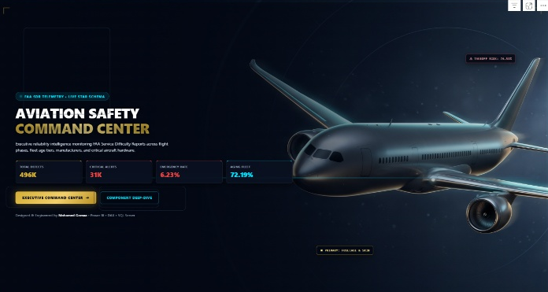

# ✈️ Aviation Safety & Fleet Reliability Command Center

An end-to-end operational intelligence solution analyzing **496,000+ FAA Service Difficulty Reports (SDR)** spanning **2019–2026** to uncover flight-phase risk patterns, fleet aging stress, OEM reliability benchmarks, and critical aircraft component failures.

---

## 📊 Executive KPIs & Key Findings

| Metric | Value | Operational Insight |
| :--- | :---: | :--- |
| **Total Defect Reports** | **496K** | Multi-year FAA SDR volume across commercial & regional fleets |
| **Critical Emergencies** | **31K** | High-severity anomalies requiring immediate precautionary procedures |
| **Critical Emergency Rate** | **6.23%** | Overall ratio of critical emergencies across all reported defects |
| **Takeoff Emergency Rate** | **76.53%** | Highest-risk flight phase (`67.91%` during Climb) |
| **Ground Inspection Capture** | **76.62%** | Majority of defects intercepted prior to flight operations |
| **Aging Fleet Share** | **72.19%** | Defects concentrated in Mature (`30k–60k hrs`) & Aging (`>60k hrs`) aircraft |

### Strategic Takeaways
* **Takeoff & Climb Concentration:** Although **76.62%** of anomalies are caught during routine maintenance, failures occurring during **Takeoff** carry a **76.53%** critical emergency conversion rate.
* **Structural Fatigue Dominance:** **Fuselage Structure** accounts for **53.01%** of the top 5 affected systems, with aircraft **SKIN** (`24.2K` reports) as the #1 failing part and **CORRODED** as the dominant physical defect mode.
* **Severity vs. Volume:** `INOPERATIVE` parts generate the highest volume (`32.8K`), while `FAULTED` (`35.12%`) and `FAILED` (`28.10%`) pose the highest critical emergency risk.

---

## ⚙️ End-to-End Architecture & Workflow

1. **Data Engineering & ETL (`Python / Pandas`)**
   * Validated schema integrity (`01_schema_check.ipynb`) and standardized **496K+** raw FAA SDR records (`02_clean_and_model.ipynb`), normalizing OEM manufacturer names (`Manufacturer_Clean`), engineering fleet age tiers, and computing reporting compliance latency (`Reporting_Lag_Days`).
2. **Data Warehousing & T-SQL Analytics (`SQL Server — AviationFailuresDW`)**
   * Modeled a **Star Schema** (`Fact_Defects`, `Dim_Aircraft`, `Dim_System`, `Dim_Date`).
   * Authored analytical queries (`Sql/aviation_reliability_analysis.sql`) utilizing **CTEs, `LAG()`, `DENSE_RANK()`, and Window Partitioning** to evaluate YoY defect velocity, OEM system rankings, and flight-phase risk.
3. **Interactive Executive Dashboard (`Power BI`)**
   * **Page 1 — Command Briefing (Home):** Custom animated HTML/CSS/SVG telemetry HUD with live DAX KPI cards and cross-page navigation.
   * **Page 2 — Executive Command Center:** Flight phase risk ranking, fleet age tier stress combo analysis, OEM defect breakdown, and system category treemap.
   * **Page 3 — Component Deep-Dive:** YoY trend velocity (`2019–2026`), defect condition risk matrix, Top 10 failing hardware components, and Top 5 systems share.

---

## 🖥️ Dashboard Preview

### 1. Command Briefing (Landing HUD)

### 2. Executive Command Center

### 3. Temporal Trends & Component Deep-Dive

---

## 📂 Repository Structure

* `Aviation_Safety_Command_Center (2).pbix` — Interactive Power BI report and Star Schema data model.
* `Aviation Safety Command Center Executive Report (1).pdf` — Executive dossier (Dashboards, Star Schema & SQL proofs).
* `scripts/` — Jupyter notebooks (`01_schema_check.ipynb`, `02_clean_and_model.ipynb`) for validation, cleaning, and modeling.
* `Sql/` — T-SQL analytical queries (`aviation_reliability_analysis.sql`).
* `images/` — High-resolution dashboard screenshots.

---

## 👤 Author

**Mohamed Gomaa** — Data Analyst & BI Developer  
* **Portfolio:** [mohamedgomaa11111.github.io/portfolio](https://mohamedgomaa11111.github.io/portfolio/)  
* **GitHub:** [@MohamedGomaa11111](https://github.com/MohamedGomaa11111)
